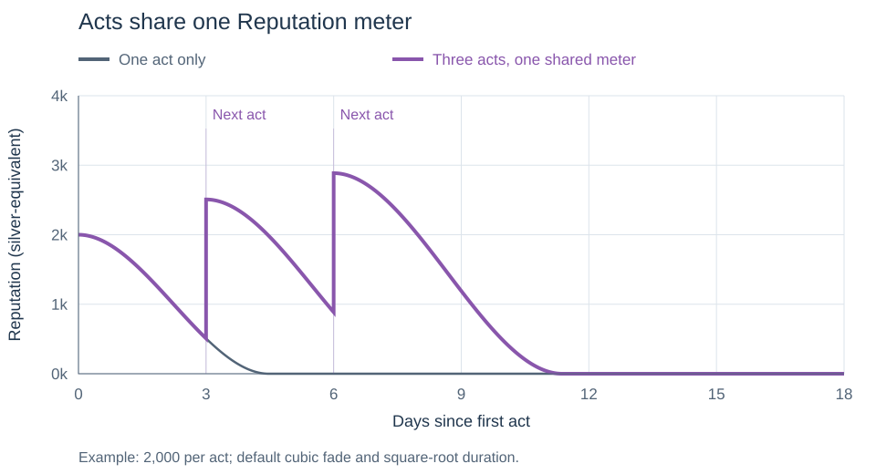
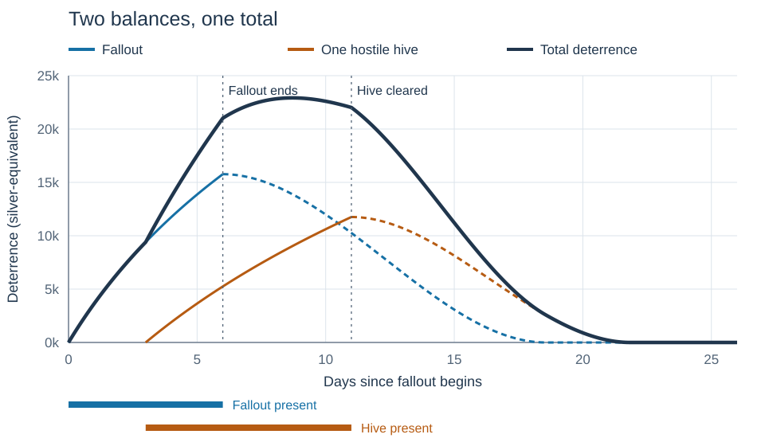
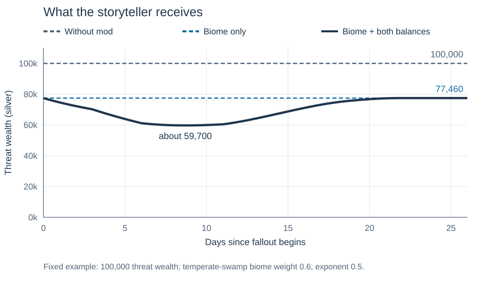

# Deterrence: a short illustrated guide

**Outsiders may avoid a dangerous place. Deterrence represents that danger and its lingering reputation. Being sick or otherwise weak earns no reduction.**

## Start with the formula

`Adjusted threat wealth = max(0, Game threat wealth - Deterrence) x biome factor x island factor`

This changes the wealth used to size threats. Actual assets keep their prices. Population, adaptation, event frequency, and minimum threat sizes still follow the game's rules.

Open **Formula** to toggle deterrence, the biome factor and the island factor independently. Meters continue tracking and fading when deterrence is off. Each disabled terrain factor uses 1. Hover a setting label or formula for help.

| Setting | Effect |
| --- | --- |
| Formula > Biome strength | The factor is w ^ strength. Here w is the biome's settlement selection weight, limited to 0 through 1. Strength ranges from 0 to 3. At 0 the factor is 1. The default 0.5 takes the square root. At 1 it equals the weight. At 3 a weight of 0.5 gives a factor of 0.125. |
| Formula > Island factor | A 0–1 multiplier for water-enclosed landmasses within the tile limit. The limit defaults to 180 world tiles and accepts 1–350. By default, the colony must be the island's sole settlement. The multiplier defaults to 0.2. At 0 the wealth contribution is zero and the game's other threat factors still apply. |
| Misc > Smoothed surface wealth | Multiplier for smoothed floors/walls in **Game threat wealth**, before the formula. **The default of 0 excludes their contribution. Set 1 for vanilla weighting.** |

The terrain factors apply directly. Mainland coasts and land that reaches a partial world's edge use island factor 1. The surface discount respects vanilla's half-value weighting of building wealth and refreshes hourly or when you press **Apply & save**.

## Corpse storage

Open the storage tab of a grave, sarcophagus or stockpile and expand **Corpses > Humanlike corpses**. Each branch starts on **Any**.

| Branch | What you select |
| --- | --- |
| Allowed status at death | Hostile, Neutral or Friendly according to the pawn's individual role. Older corpses use a saved estimate from their faction. |
| Allowed faction status | The faction's current diplomatic status. A peace treaty can change which bodies qualify. |
| Allowed factions | Named factions in this game, including the player faction, and Factionless. |

Choose any combination inside a branch. All three branches and the vanilla filters must allow the body. Use **None** to reject every humanlike corpse at an ordinary destination. An explicit grave assignment reserves the grave for its assigned pawn even with **None** selected. Copy and paste storage settings to apply the same rules elsewhere.

## Three meters

| Meter | How it works | When the source ends |
| --- | --- | --- |
| **Remains** | Bodies maintain a fixed amount. Kept prisoner organs maintain a fraction of their current market value. | Each removed body's amount fades separately. Organ-stock value ends on removal, without another tail. |
| **Reputation** | A qualifying death, prisoner surgery or execution, or ritual adds a one-time gain to one shared balance. | Fading starts immediately. Every positive gain adds to what remains and restarts the shared fade. |
| **Hazards** | Pollution, toxic conditions, hostile hives, and outdoor extremes accumulate with diminishing returns. | Each source type fades separately after its exposure ends. |

Open meters from the shield badge beside **World**, or use **Formula > Options > Open meters**. The pie chart shows how much Remains, Reputation, and Hazards each contribute to the current map. Hover a slice or legend entry for its amount and percentage. Expand a meter to see its sources. Body rows identify burials, and arrows locate a body, grave, organ, or container.

## Remains: bodies and organs

Bodies use the pawn kind's fixed **combat power**, not individual skills, health, gear, or corpse condition. Proper burials keep the same contribution. Exhuming and reburying the same body does not add another entry.

| Body | New-setting default per combat power |
| --- | --- |
| Hostile human | 5 |
| Hostile mechanoid | 5 |
| Hostile / manhunter animal | 1 |

Ordinary hunted animals do not qualify. Existing settings are preserved: to lower an older animal weight, use **Remains > Animal remains > Low (1) > Apply & save**. Amounts also accept typing, sliders, and minus/plus buttons. The body switch is independent of Reputation.

New natural organs harvested locally from prisoners are marked and count while kept: **market value x 0.75** by default. Adjust this from 0 to 5 under **Kept prisoner organs**. Bought or old unmarked organs do not qualify. Selling, using, destroying, or removing stock ends this portion on refresh. The harvest's separate Reputation gain keeps fading.

## Reputation: one shared memory

| Act | Default gain |
| --- | --- |
| Hostile death | Combat power x 5; humans also include original weapons/apparel value |
| Prisoner organ harvest | 1,000 |
| Failed removal surgery | 333 |
| Successful amputation without an organ | 500 |
| Prisoner execution | 2,000 |
| Selected ritual reward | 5,000 |

One surgery earns one outcome. Prisoner deaths do not also earn ordinary hostile-death gains. Human gear is captured before downing or direct death; stripping afterward cannot rewrite it.

With **Ideology**, choose **reputation boost** as a ritual's normal bonus reward. Positive outcomes then add Reputation; other rituals earn nothing automatically. Adjust the amount under **Reputation > Ritual reward**.

Later acts restore no lost value. Even a small positive gain can prolong a large surviving balance; zero or disabled gains cannot renew it. The breakdown shows each act's remaining share, keeping 40 recent acts plus **Earlier reputation**. Old saves use that aggregate for unrecorded history.

## Hazards: separate sources can overlap

Each environmental type has one balance per home map. Sequential toxic fallouts resume the same surviving fallout balance and diminishing returns; fully faded sources start fresh. Pollution is separate. Duplicate copies of one condition do not multiply its rate.

Fallout ends near 15,769; the hive ends near 11,756. Their fades last about 12.6 and 10.8 days. The total can keep rising after fallout ends because the hive is still active.

Actual outdoor heat/cold counts, including temperatures caused by heat waves and cold snaps. Named events grant no separate bonus and have no settings. Their old separate balances are discarded on upgrade. Biome and temperature may both apply. Ground pollution requires Biotech.

Acid Rain and Toxic Rain are optional mod conditions. Their controls appear when a loaded mod supplies the corresponding definition. Toxic Fallout is a separate base-game event.

Illness, solar flares, eclipses, psychic drones, volcanic winter, poor soil, and swamp terrain give no deterrence.

## Tune the curves

Settings follow **Formula, Remains, Reputation, Hazards, Curves, Summary, Misc, Presets**. The bottom of Formula has **Colony size scaling**, **Faction overrides**, and **Open meters**. Colony size scaling reveals sample colonist inputs and additional Summary columns. This display preference applies to Global and every faction. Saved gameplay scaling applies while its controls are hidden.

**Curves** puts the live plot beside scrollable growth and fade controls on wide windows. On narrow windows the plot sits above them. The preview offers Hazard overlap, Repeated acts, and Combined views. **By total exposure** slows hazards as raw exposure accumulates. **By daily rate** gives stronger hazards a longer slowdown time, calibrated at 2,000 points/day. Both use one shape slider: 0 for linear growth, 0.5 for square root, and 1 for logarithmic growth.

Default fading is a smooth cubic curve. **10,000 deterrence lasts 10 days**, scaled by the square root of the ending amount: four times as much lasts twice as long. The duration exponent adjusts this scaling. Switch to **Hazard history** to use an ongoing hazard’s area in point-days. The reference area defaults to 20,000 point-days. Reputation and removed bodies use starting balance. A fade in progress keeps its saved shape and duration.

Existing fades keep their saved shape and duration. Newly ended sources and renewed Reputation use current controls. Press **Apply & save** to refresh the map; History plots actual wealth, Game threat wealth, Adjusted threat wealth, and deterrence.

**Summary** shows the selected scope's formula and standard examples. Examples include a 100-power body or death, original human gear worth 1,500, stock worth 1,000, one act, or one day of a hazard at the stated exposure. The default view uses five colonists. Colony size scaling reveals columns for 1, 5, 10, and 20. Click a row to edit it.

## Optional faction overrides

Check **Faction overrides** in **Formula > Options** to show **Settings for**. Select a faction type to edit its settings. Untouched values follow Global, including later changes. **Reset to Global** clears that faction's overrides. **Summary** follows the selected faction.

Faction settings affect the size of ordinary enemy raids on colony maps. The storyteller still chooses the faction using the shared Global budget. Incidents with explicit raid budgets keep their assigned points. The Global meters and history report the shared values.

If you first customize a source or curve, that faction starts with the colony's current Global balance. New gains and fades then use the faction's settings. Running fades keep their saved timing. Press **Apply & save** to apply changes.

## What changes about raids

The storyteller controls when it attempts raids. Threat wealth feeds the points budget alongside population, adaptation, and difficulty. Points can qualify or rule out some incidents.

For an ordinary enemy raid, RimWorld draws from eligible factions. The draw is weighted by the shared point budget and faction rules. A scripted event can assign a faction or budget. Once the game picks a faction in a standard raid, Deterrence can apply that faction's settings to the raid size. The game then applies its usual strategy and arrival adjustments.

## Save and restore settings

In **Presets**, type a name and select **Save new**. Pick a saved preset to load, rename, overwrite, or delete it. Presets include Global settings and faction overrides. Deterrence balances and wealth history stay with the save.

This guide describes **Deterrence 0.9.0**, formerly Antiwealth.
