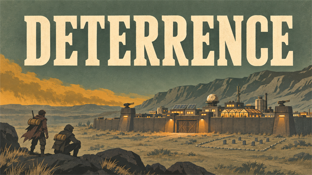
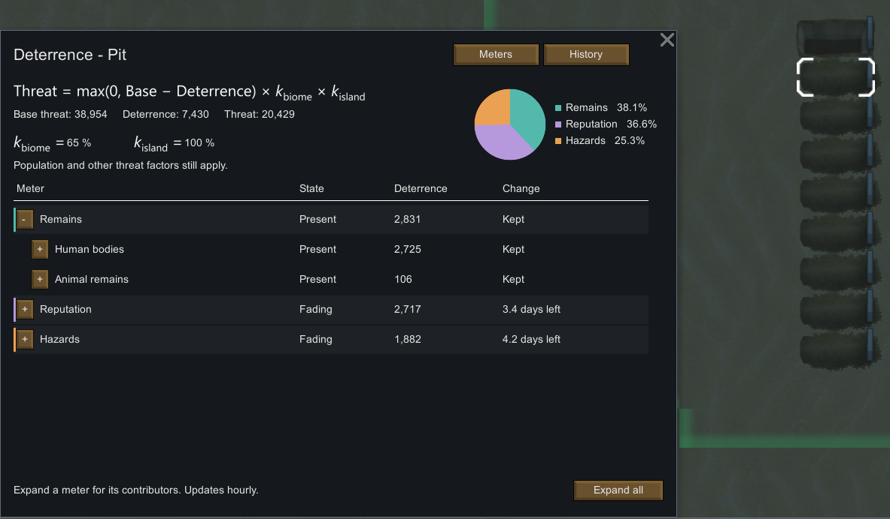

# Deterrence



Deterrence changes how RimWorld sizes outside threats. A wealthy colony surrounded by toxic fallout and the graves of failed raiders can attract a smaller raid than an equally wealthy colony on safe ground. Your stockpiles keep their market value.

**RimWorld 1.6 · Requires Harmony · Core features work without DLC**

## What counts toward deterrence?

| Meter | What contributes |
| --- | --- |
| Remains | Hostile bodies, including those buried in graves, and organs harvested locally from prisoners. |
| Reputation | Hostile deaths, prisoner surgeries and executions, and an optional Ideology ritual reward. Reputation fades over time. |
| Hazards | Pollution, toxic events, hostile hives, and extreme outdoor temperatures. Their effects build during exposure and fade afterward. |

Open the shield beside **World** to see how much each meter contributes and which bodies, events, or hazards account for it. In mod settings you can tune weights and growth curves, adjust biome and island factors, and give different factions their own response to the same colony.



Graves, sarcophagi, and stockpiles also gain three filters under **Storage → Corpses → Humanlike corpses**. Choose which corpses to accept by status at death, current faction relations, or individual faction. All three start on **Any**.

## Install 0.11.1

1. Download this repository using **Code → Download ZIP** and extract it.
2. Copy the inner `Antiwealth` folder into your RimWorld `Mods` folder. The installed path should end in `Mods/Antiwealth/About/About.xml`.
3. Enable **Harmony**, then **Deterrence**, and restart RimWorld.

On Windows with the default Steam installation, you can close the game and run `Update-Deterrence.bat` from the extracted folder instead. It backs up an existing installation. Keep the folder name `Antiwealth` when upgrading an older copy. The package ID stays `pavel.antiwealth` for save compatibility.

## Guides and development

- [Player guide](Antiwealth/Deterrence-Guide.md)
- [Settings, presets, and compatibility](Antiwealth/README.md)
- [Changelog](Antiwealth/CHANGELOG.md)
- [Corpse storage test checklist](Antiwealth/TESTING-0.11.0.md)

The compiled mod is included in `Antiwealth/Assemblies`. To build from source on Windows, install the .NET 10 SDK and run the following in PowerShell with paths to your RimWorld 1.6 installation and Harmony assembly.

```powershell
cd Antiwealth
.\Build.ps1 -GameRoot 'D:\SteamLibrary\steamapps\common\RimWorld' -HarmonyPath 'D:\SteamLibrary\steamapps\workshop\content\294100\2009463077\1.6\Assemblies\0Harmony.dll'
.\Test.ps1
```
